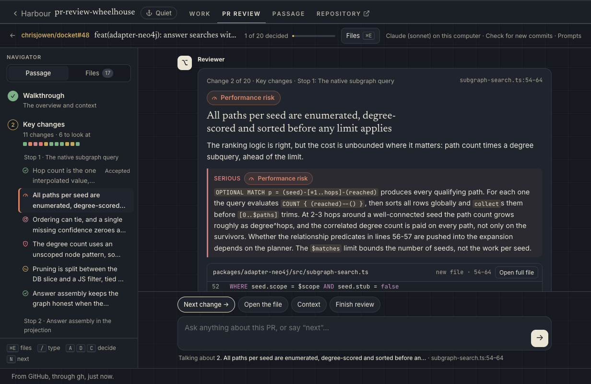
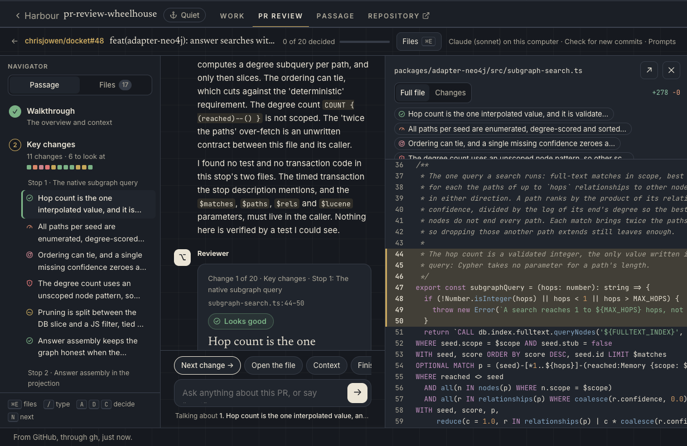
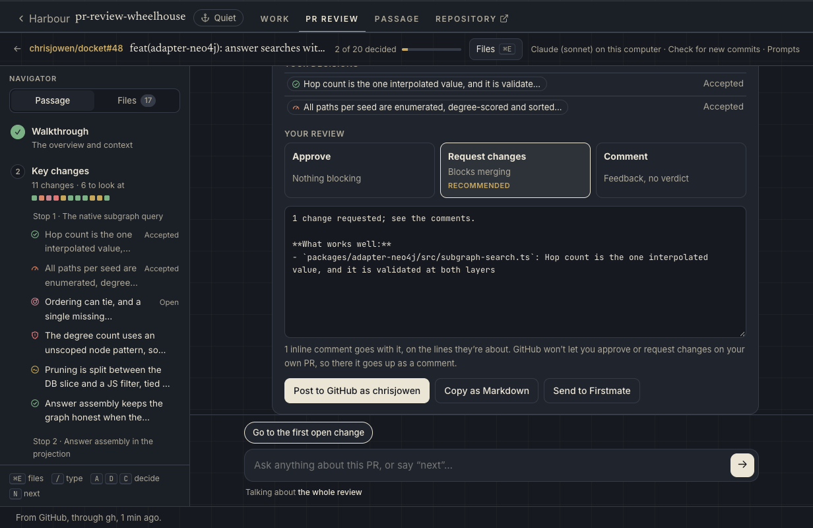
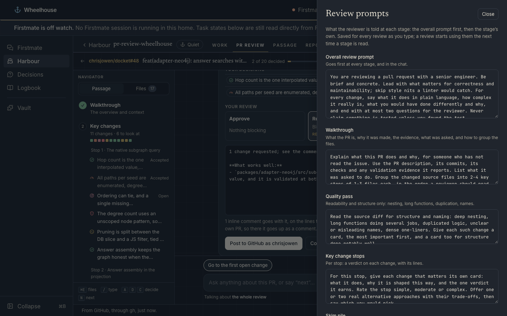

# pr-review-wheelhouse

A [Wheelhouse](https://github.com/chrisjowen/wheelhouse) plugin that adds a **PR review** tab to each project. Point it at a pull request and a reviewer reads the whole PR, then walks you through it in a chat, one change at a time, instead of handing you the list of changed files.



It is the same review screen as the [PR review web app](https://github.com/chrisjowen/pr-review-app) at pr.chrisjowen.net: the screens live here, in `wheelhouse/ui/`, and each host plugs in its own sign-in, reviewer and GitHub. In Wheelhouse they are all on your computer:

- the reviewer is Claude through your own Claude Code sign-in (or a local Ollama model), so a review costs nothing extra;
- `gh` reads the pull request and posts your review, signed in as you, so private repositories just work.

Clicking Review goes straight into the review, with nothing to click in between:

1. **An overview** of the PR: what it does, what needs your attention, what was asked and whether it's met, its checks, the shape of the review (every change, coloured by its verdict), and a diagram of **how the change fits together** (see [The structure diagram](#the-structure-diagram)).
2. **The major issues**, one message each, most serious first: the changes with a verdict that blocks (security, then acceptance criteria, performance and tests; a low-severity security issue last). Each says where it sits (a stop of the _Key changes_, the _Quality pass_, which opens with every concern in the review as a checklist, or the _Skim pile_).
3. **The minor issues**, only if you ask: once every major issue is decided, the chat offers them (code smells, over-complex code) or to finish. A change with no concern at all (praise, an explanation) is only a reference point: the chat never walks it, and the navigator lists it only when you turn **Reference points** on. A stop with nothing but reference points is hidden the same way. **Context** on _the project as a whole_ (its description and README) or _the story_ behind the PR (why it was made, what the author showed works, its description) is a button away throughout.

Each change has its main verdict and maybe a second one (Looks good, Explanation, Exemplary, Code smell, Over-complex, Not well tested, Doesn't meet acceptance criteria, Performance risk, Possible security issue), filed as _What I like_, _Worth knowing_, _Needs work_ or _Serious_. Serious is the verdicts that block: security, acceptance criteria, tests and performance. The code comes with its key lines highlighted and **Open full file**, a problem comes with a suggestion, and follow-up questions sit under it. 4. **Accept**, **Disagree** or **Comment** on each change (or `A`, `D`, `C`); deciding moves on to the next open change. Type anything to ask the reviewer about the change in front of you (a line number opens the file there too), or "next", "back", "finish". 5. **Finish review** drafts your verdict: _Request changes_ once you've accepted a blocking concern, _Comment_ for other feedback, _Approve_ otherwise. Post it to the pull request, copy it as Markdown, or send the change requests to Firstmate.

## Install

```sh
wheelhouse plugin install chrisjowen/pr-review-wheelhouse
```

Or use **Settings → Plugins → Install plugin** with `chrisjowen/pr-review-wheelhouse`. The plugin is off until you turn it on in **Settings → Plugins → PR review**, for every project or only some. Each project then gets a **PR review** tab at `/projects/<project>/pr-review/review`.

You need:

- `gh`, signed in (`gh auth login`), to read pull requests and to post reviews;
- [Claude Code](https://claude.com/claude-code) (`claude`), signed in, for the default reviewer; or Ollama with a model pulled (`ollama pull qwen2.5:7b`) if you choose Ollama.

## Using it

The tab lists the project's open pull requests and takes any GitHub PR URL. Nothing is read or reviewed until you click Review. The tab reopens the review you had open last, as the engine kept it, without reading the PR again, and **Reviews you started** picks any other up where you left it; **Check for new commits** in the review's bar reads it again with `gh`. `?pr=<number or URL>` on the tab's address is a click on Review: it shows a PR the engine already keeps, and reads and reviews any other straight away. The tab declares `opensPullRequest: '?pr={url}'`, so a Review link on a Wheelhouse chat card opens the PR's review here directly. Older Wheelhouse versions ignore that field. The review you had open last, if the engine no longer keeps it, waits in the URL box for your click.

The first time, the tab asks you to **Start the engine**. The engine is the plugin's companion service, a small server on `127.0.0.1` that does the slow work: reading the PR, the reviewer's passes, the chat, and posting. Wheelhouse starts it only on that click. It keeps running after Wheelhouse stops, and it opens a tab that closes itself.

Opening a PR reads it with `gh` (description, commits, checks and diff), sorts the changed files, and runs the walkthrough, which writes the overview and proposes the stops. The plugin holds that proposal to the real file list, so the reviewer can't hide a source file as "generated", put a test or doc in a stop, or leave the biggest change out. The other passes then run one at a time behind it, and the one the chat is about to reach goes first; if you get there before it's done, the chat says so and carries on when it is. A review is kept per PR head, so reopening a PR costs nothing, and a new push starts a fresh review.

Beside the chat, never instead of it, the **navigator** lists the passage's groups and stops (each change as a dot in its verdict's colour) and every changed file, GitHub-style, with a filter. Ctrl+E (⌘E on a Mac) opens a quick switcher over the files and changes; jumping anywhere moves the conversation there. **Open full file** shows the file whole in a drawer, at the head the review was made at, with its lines lit and its changes a tab away.



A disagreement can be remembered for this PR, for you, or for everyone reviewing the repo. For now it is kept with the review, for a later memory feature.

### Finishing

**Finish review** (in the navigator, or say "finish") lists what you decided and suggests a verdict. The draft is editable.

- **Post to GitHub** posts a pull request review on the head you reviewed, with `gh`, as the account `gh` is signed in as. The changes you accepted or commented on become inline comments when their lines sit inside one hunk of the diff; the rest go in the summary with their file and lines. GitHub doesn't let you approve or request changes on your own pull request, so there it goes up as a comment, and the chat says so. Once it's posted, Finish shows the posted review instead of offering to post again. With **Put the diagram on the pull request** (on by default), the structure diagram goes in the review too; see [The structure diagram](#the-structure-diagram).
- **Copy as Markdown** copies the PR, the verdict, the commit reviewed, the summary and the line comments.
- **Send to Firstmate** shows the message: the PR's URL, then each change with its file and lines. **Open in Firstmate's chat** puts it in Wheelhouse's chat box, the same handoff the GitHub issues plugin uses. Nothing is sent until you send it there.



### The structure diagram

When the PR changes source the plugin can read (JavaScript and TypeScript, Python, Go, Rust, CSS), the engine draws **how the change fits together** as an SVG, from the diff alone and without the model, so the same diff always draws the same picture. Each changed file is a box (green new, amber changed, red removed) with the functions, classes and types it adds (+), changes (~) or removes (−); arrows are the imports between them the PR adds (green), removes (red, dashed) or keeps (grey). Files sit left of what they import. An unchanged file or a package gets a box only when the PR adds or removes an import of it. At most 18 changed files are drawn, source first, then the biggest changes; the rest are counted. The SVG carries its own light and dark colours.

The chat shows it in the overview (click it for full size). Posting the review with the diagram commits it, with `gh`'s Git data API, to a branch of its own in the PR's repository, `pr-review-diagrams` (made the first time, never merged, and apart from the PR's own branch), as `pr-<number>/<head>-structure.svg`, and the review's text shows it from that commit, so GitHub shows it inline to whoever can see the repository. If it can't go up (you can't push to the repository, say), the review still posts, and the chat says why.

### Prompts

**Review prompts**, under the pull requests, and **Prompts** in a review's bar open the overall review prompt and the four stage prompts (walkthrough, quality pass, stops, skim pile). They are saved for every review as you type. Each pass gets the overall prompt first, then its stage's prompt, then only that stage's context, then a fixed description of the JSON to answer with. That last part isn't editable, so a reworded prompt can't break how the answer is read. **Start the review over**, at the foot of the panel in a review, reads the PR again with the prompts as they are now and forgets your decisions and the chat.



## Settings

Change these in **Settings → Plugins → PR review**, or under `plugins["pr-review"].settings` in Wheelhouse's `plugins.json`. The tab hands them to the engine as it connects, so they apply without restarting the engine.

| Setting                 | Key             | Default                  | What it does                                                                                          |
| ----------------------- | --------------- | ------------------------ | ----------------------------------------------------------------------------------------------------- |
| Reviewer                | `backend`       | `claude`                 | `claude`: Claude through Claude Code. `ollama`: a local model through Ollama.                         |
| Claude model            | `claudeModel`   | `sonnet`                 | The model Claude Code reviews with, such as `sonnet`, `opus` or a full model id.                      |
| Ollama model            | `ollamaModel`   | `qwen2.5:7b`             | The Ollama model each stage runs on, when the reviewer is Ollama.                                     |
| Ollama address          | `ollamaUrl`     | `http://127.0.0.1:11434` | Where Ollama answers.                                                                                 |
| Context window (tokens) | `contextTokens` | `16384`                  | How much an Ollama model reads at once (Ollama's own default, 2048, is too small for a stage's diff). |

### How Claude runs

The default reviewer is `claude -p`, Claude Code's non-interactive mode. It runs once per stage and once per chat answer, and loads none of your own setup:

- `--setting-sources ""`, so none of your user, project or local settings load;
- `--settings` with this plugin's own [`claude-settings.json`](wheelhouse/engine/claude-settings.json), which turns every hook off;
- `--tools ""`, `--strict-mcp-config` and `--disable-slash-commands`, so it has no tools, no MCP servers and no skills, and can only answer;
- `--no-session-persistence`, so no session is saved;
- it runs from the engine's own empty directory, with `FM_NO_LOCK=1`, so it never picks up Firstmate's hooks or lock.

It uses the sign-in Claude Code already has. A Wheelhouse that runs with its own `CLAUDE_CONFIG_DIR` can point the reviewer at another one with `PR_REVIEW_CLAUDE_CONFIG_DIR`; `default` means Claude Code's default.

### A local model instead

With `backend` set to `ollama`, each stage is one Ollama `/api/chat` call. A 7B model such as `qwen2.5:7b` is usable but generic: it takes 20 to 45 seconds a stage on an Apple-silicon Mac, and it is weak at grouping files from a raw diff. That is why the walkthrough reads a manifest of the files (names, kinds and sizes) rather than the diff, and why the plugin checks its grouping.

## Using the engine in another host

The engine and the review screens are plain modules, so another host can run them itself. The [PR review web app](https://github.com/chrisjowen/pr-review-app) does, pinning this repo by commit. Nothing here changes the plugin: in Wheelhouse the reviewer is still Claude or Ollama, and the tab is as described above.

### The chat review in another host

`wheelhouse/ui/chat.js` is the chat review on its own: the `<pr-review-chat>` element, and `mountChat(root, host)` to draw it into any root. It has no build step and imports only its neighbours (`chat-core.js`, `chat-styles.js`, `draft.js`, `styles.js`). It draws in its own shadow root, on the page's CSS variables (`--background`, `--foreground`, `--card`, `--border`, `--primary`, `--brass`, `--sea` and the rest, as Wheelhouse and the web app both set them), so it follows the page's light or dark theme. The chat never reaches the network itself; everything goes through the `host` it is given:

```js
import 'pr-review-wheelhouse/wheelhouse/ui/chat.js';

const chat = document.createElement('pr-review-chat');
chat.host = {
	pr: 'https://github.com/owner/repo/pull/12',
	// id: 'owner__repo__12',     // a review the host has already opened; else the chat opens it
	// Storage, and the reviewer behind it: the engine's API.
	api: (method, path, body) => callTheEngine(method, path, body),
	// Who is reviewing, to tell their own pull request.
	identity: { login: async () => 'octocat' },
	// The model backend: whether it answers now, and what to say when it can't.
	reviewer: { live: true, name: 'Claude (sonnet)', offline: 'Add a key to ask questions.' },
	// GitHub: whether Finish posts (else it copies), a changed file whole, the project.
	github: {
		post: true,
		file: async (review, path) => 'the file’s text at review.pr.headSha',
		project: async (review) => ({ repo, url, description, language, topics, stars, readme })
	},
	features: { firstmate: false }, // Send to Firstmate, in Finish
	back: { title: 'The reading plan', href: '/owner/repo/pull/12' }, // or onClick
	links: [{ text: 'Account', href: '/account' }], // more of the bar; each an href or an onClick
	note: 'Claude (sonnet) on your key' // a line about the reviewer, in the bar
};
document.body.append(chat);
```

`api` takes the engine's paths (`/api/reviews`, `/api/reviews/<id>`, `…/focus`, `…/run`, `…/ask`, `…/card`, `…/post`) and answers with the engine's JSON, rejecting with an `Error` that says what went wrong. In Wheelhouse, the tab hands the chat its engine, and its `file`, `project` and `login` are the engine's own reads with `gh` (see [What it reads and writes](#what-it-reads-and-writes)). `chat-core.js` is the chat's logic without the page (what a card says, the reading order, when to offer context, what a typed line means), and Node's tests read it as the page does.

### An OpenAI-compatible reviewer

`createOpenAI` in `wheelhouse/engine/model.js` reviews through any OpenAI-compatible chat completions endpoint: [OpenRouter](https://openrouter.ai), OpenAI, or a server of your own (vLLM, llama.cpp, Ollama's `/v1`). The plugin's settings don't offer it; a host builds it and hands it to `createReviews` and `createHandler` as `main.js` does with the other two.

```js
import { createOpenAI } from 'pr-review-wheelhouse/wheelhouse/engine/model.js';

const model = createOpenAI({
	baseUrl: 'https://openrouter.ai/api/v1',
	apiKey: process.env.OPENROUTER_API_KEY, // read from the environment, never committed
	model: 'anthropic/claude-sonnet-4.5',
	maxTokens: 8000
});
```

| Option        | Default    | What it does                                                                                    |
| ------------- | ---------- | ----------------------------------------------------------------------------------------------- |
| `baseUrl`     | (required) | The API's base address; the engine posts to `<baseUrl>/chat/completions`.                       |
| `apiKey`      | none       | Sent as `Authorization: Bearer <key>`. Leave it out for a local server that needs none.         |
| `model`       | (required) | The model id the provider knows, such as `anthropic/claude-sonnet-4.5` on OpenRouter.           |
| `maxTokens`   | `0` (none) | Caps each answer (`max_tokens`), so a host can bound what one call may cost before it makes it. |
| `temperature` | `0.2`      | Sampling temperature.                                                                           |
| `headers`     | `{}`       | Extra request headers, such as OpenRouter's `HTTP-Referer` and `X-Title`.                       |
| `timeoutMs`   | 5 minutes  | How long one answer may take.                                                                   |

Each answer is streamed, and asks for usage in its last chunk. Besides the usual text and token counts it reports `costUsd`, the cost the provider says the call had (OpenRouter's `usage.cost`), or `null` when the provider doesn't say.

### Cards: one verdict per change

The engine also writes the review as **cards**, one per change. The chat review shows them a change at a time, in the plugin's tab and in the web app.

Cards cost no extra calls. The stops, the quality pass and the skim pile each write their cards in the one call they already make, and the walkthrough lists what the PR was asked to do (its acceptance items, from the description) for the cards to check against. A card's chat reads only that card, its lines and its own files, so it is cheaper than a stage's.

Every card has one main verdict from a fixed set and at most one secondary one:

| Verdict                          | Id          | Family  | Accepted, it becomes                       |
| -------------------------------- | ----------- | ------- | ------------------------------------------ |
| Exemplary                        | `exemplary` | praise  | a line under "What works well"             |
| Looks good                       | `lgtm`      | praise  | a line under "What works well"             |
| Explanation                      | `explain`   | neutral | nothing; it's noted                        |
| Code smell                       | `smell`     | concern | a suggestion                               |
| Over-complex                     | `complex`   | concern | a suggestion                               |
| Not well tested                  | `untested`  | concern | a change request                           |
| Performance risk                 | `perf`      | concern | a change request                           |
| Doesn't meet acceptance criteria | `ac`        | concern | a change request                           |
| Possible security issue          | `security`  | concern | a change request; it always has a severity |

The set, with each verdict's meaning, is `CARD_VERDICTS` in [`wheelhouse/ui/cards.js`](wheelhouse/ui/cards.js), which a page can import as it is.

A card, as kept in `results[stage].cards`:

```js
{
	id: 'stop-1:c2',            // the stage's id, then the card's place in it
	stage: 'stop-1',
	verdict: 'security',
	secondary: 'untested',      // or null
	severity: 'low',            // with security only; else null
	title: 'The degree counts relationships in other scopes',
	why: 'What the change does and why it earns the verdict.',
	suggestion: 'Count only edges in scope.', // concerns only; else ''
	ask: 2,                     // the acceptance item it checks, or null
	asked: 'Rank by score times path confidence', // what was asked, for ac
	file: 'src/subgraph-search.ts', from: 59, to: 60, // or null: about the change as a whole
	blocks: [{ file, from, to }], // the lines it shows: its own, then up to two more
	take: 'The reviewer’s opening line in the card’s chat.',
	questions: ['Suggested questions for the card’s chat']
}
```

Every answer that is a review also carries **`deck`**, the review laid out as cards. It is worked out for each answer and never kept:

| Field      | What it holds                                                                                                                                                                                                                                                                                                                                                                                                                                                                                                   |
| ---------- | --------------------------------------------------------------------------------------------------------------------------------------------------------------------------------------------------------------------------------------------------------------------------------------------------------------------------------------------------------------------------------------------------------------------------------------------------------------------------------------------------------------- |
| `verdicts` | `CARD_VERDICTS`.                                                                                                                                                                                                                                                                                                                                                                                                                                                                                                |
| `groups`   | The passage, in reading order: **Walkthrough** (with `asks`, each acceptance item and the cards that check it), **Key changes** (with `stops`, each stop's title, files and cards), **Quality pass** (its own cards, and `checklist`: every concern in the review, with its decision), **Skim pile** (with `files`, one line each) and **Generated** (`hidden: true`, with `files` and one card, made without the model). Each group has its `stages`, `state`, `cards` (ids), `look` (concerns) and `decided`. |
| `cards`    | Every card in reading order, each with its `group`, its `tier` and the captain's `decision` (or null).                                                                                                                                                                                                                                                                                                                                                                                                          |
| `tiers`    | How many cards are in each tier: `major` (a blocking verdict, main or secondary), `minor` (any other concern) and `reference` (no concern). A stop in `groups` has the `tier` of its most serious card.                                                                                                                                                                                                                                                                                                         |
| `counts`   | How many cards have each verdict.                                                                                                                                                                                                                                                                                                                                                                                                                                                                               |
| `remember` | The disagreements and comments the captain asked to remember: `{ card, scope, verdict, decision, text, file, repo, at }`. Nothing reads these back yet.                                                                                                                                                                                                                                                                                                                                                         |

A page acts on cards with two calls:

- `POST /api/reviews/<id>/card` with `{ card, decision, text, remember }` records the captain's decision: `accept`, `disagree` (with an optional reason) or `comment` (with its text), or `null` to take it back. `remember` is `pr`, `me` or `repo` (who to remember a disagreement or comment for), or `null`.
- `POST /api/reviews/<id>/ask` with `{ stage, card, text }` asks in that card's own chat. The answer arrives in `chat[<card id>]`, as a stage's does in `chat[<stage id>]`.

Reading a stage again writes new cards, so it drops that stage's cards' chats and decisions.

The draft review counts the card decisions along with the change requests and kept suggestions: an accepted blocking concern makes it **Request changes**, other accepted concerns and comments make it **Comment**, and each sits inline on its lines when they are inside one hunk. Accepted praise goes under "What works well"; disagreements add nothing.

A review kept from before cards, and an answer in the older shape, still read as cards: each quality finding becomes a code smell, and each stop note an explanation (or a code smell when it raised a concern).

### What the host lets the tab do

The `pr-review-tab` element reads `host.features`. Wheelhouse sets none of them, so the plugin keeps its defaults.

| Feature     | Default | What it does                                                                                                   |
| ----------- | ------- | -------------------------------------------------------------------------------------------------------------- |
| `post`      | on      | **Post to GitHub** in Finish review. Off, **Copy as Markdown** becomes the main button.                        |
| `firstmate` | on      | **Send to Firstmate** in Finish review.                                                                        |
| `autoOpen`  | on      | A `?pr=` link the engine doesn't keep opens straight away. Off, it waits in the URL box for a click on Review. |

When a host's `github.post` answers with an `event` other than the one asked for (say, a comment on the captain's own pull request) and a `note` saying why, the review keeps both in `posted`, and the chat shows the note. The plugin's own `gh` does this for your own pull request.

The tab's data can also carry `settings.label`, the reviewer's name to show, and `settings.where`, how it runs (shown after the name, such as "through OpenRouter"; else "on this computer"). The Markdown copy comes from `reviewMarkdown(review, finish, body, draft)` in `wheelhouse/ui/draft.js` (also exported from `wheelhouse/ui/index.js`).

## What it reads and writes

The Wheelhouse side is read-only. Its provider runs one `gh pr list` in the project's clone to list the open pull requests.

The engine:

- reads with `gh pr view` and `gh pr diff`;
- for the chat, reads one of the review's changed files whole at the head it was made at (`GET /api/reviews/<id>/file?path=…`, with `gh api repos/<owner>/<repo>/contents/<path>?ref=<head>`; any file the PR doesn't change, and any binary file, is refused), the project's description, topics and README (`GET /api/reviews/<id>/project`, with `gh api repos/<owner>/<repo>` and `…/readme`), and who `gh` is signed in as (`GET /api/identity`, with `gh api user`);
- posts with `gh api -X POST repos/<owner>/<repo>/pulls/<n>/reviews`, only from **Post to GitHub** after you confirm;
- with the diagram, first commits it to the repository's `pr-review-diagrams` branch (`gh api` on `repos/<owner>/<repo>/git/ref`, `git/trees`, `git/commits` and `git/refs`), in the same click;
- keeps your prompts and one file per review in its state directory: `$PR_REVIEW_STATE_DIR`, else `$XDG_STATE_HOME/pr-review-wheelhouse`, else `~/.local/state/pr-review-wheelhouse`.

It answers only on `127.0.0.1`, and only requests that name this computer as their host. A request from a page must come from a page on this computer, and a request that changes anything must carry a header that a plain form from another site can't send.

## Development

```sh
npm install
npm run lint   # eslint and prettier
npm test       # node --test
npm run engine -- --port 4791   # the engine on its own
```

The plugin has no runtime dependencies and no build step. Wheelhouse imports `wheelhouse/server/index.js` and serves `wheelhouse/ui/` to the page as is.

- `.wheelhouse-plugin/plugin.json`: the manifest.
- `wheelhouse/server/index.js`: the open-PRs provider, the tab and the engine service.
- `wheelhouse/engine/`: the engine.
  - `main.js` and `http.js`: the server.
  - `review.js`: the review sessions and the one-at-a-time queue.
  - `stages.js` and `classify.js`: grouping the files into stages.
  - `prompts.js`: assembling the prompts and reading the answers.
  - `model.js`: the reviewer, Claude Code, Ollama or an OpenAI-compatible API, behind one interface.
  - `github.js`: `gh`.
  - `diff.js`: reading the diff.
  - `diagram.js`: the structure diagram, from the diff.
- `wheelhouse/ui/`: the review screens, shared with the web app.
  - `index.js`: the `pr-review-tab` element: the engine, the pull request picker, the prompts, and the chat with Wheelhouse's host.
  - `chat.js`: the `pr-review-chat` element, the chat review itself; `chat-core.js`, its logic without the page; `chat-styles.js`, its styles.
  - `styles.js`: the shared tokens and the tab's styles.
  - `draft.js`: drafting the GitHub review, its Markdown and the Firstmate message, shared with the engine.
  - `cards.js`: the verdict set and the deck of cards, shared with the engine.

The tests use a fake `gh`, a fake model and a fake `claude`, so they need none of the three installed. `test/ui.test.js` drives the tab and the chat in a page (happy-dom) against the real engine over HTTP; `test/chat-core.test.js` reads the chat's logic against a real review the web app seeds (`test/fixtures/docket-48.review.json`).

## Licence

MIT
