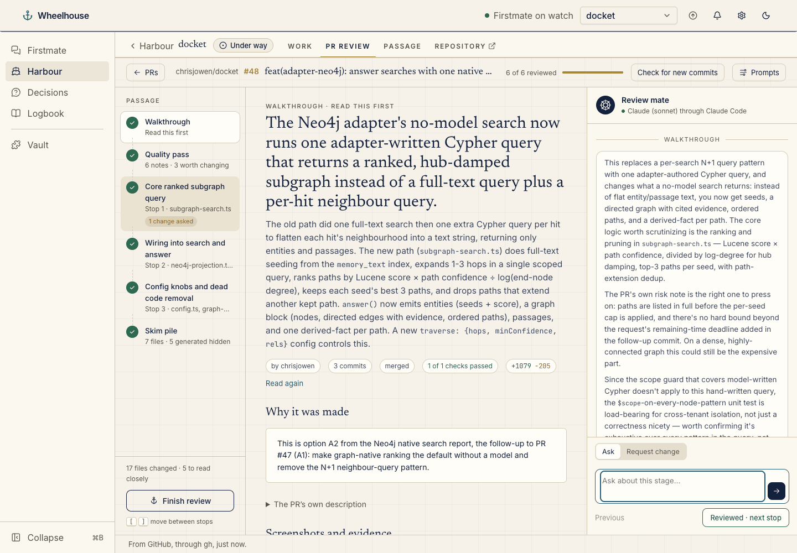
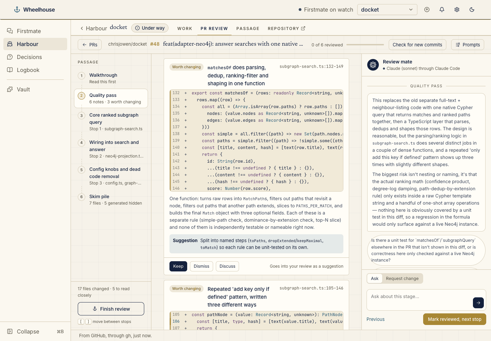
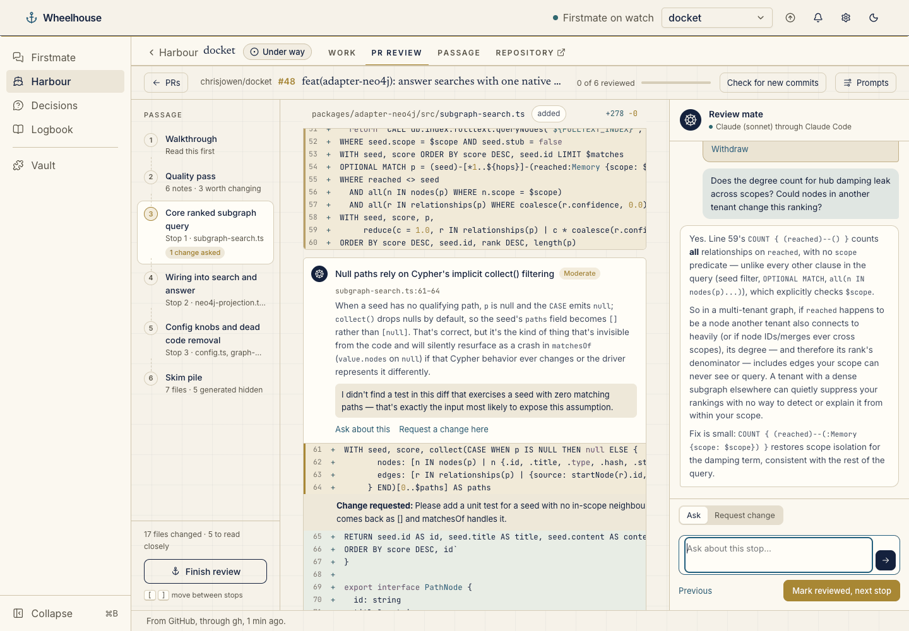
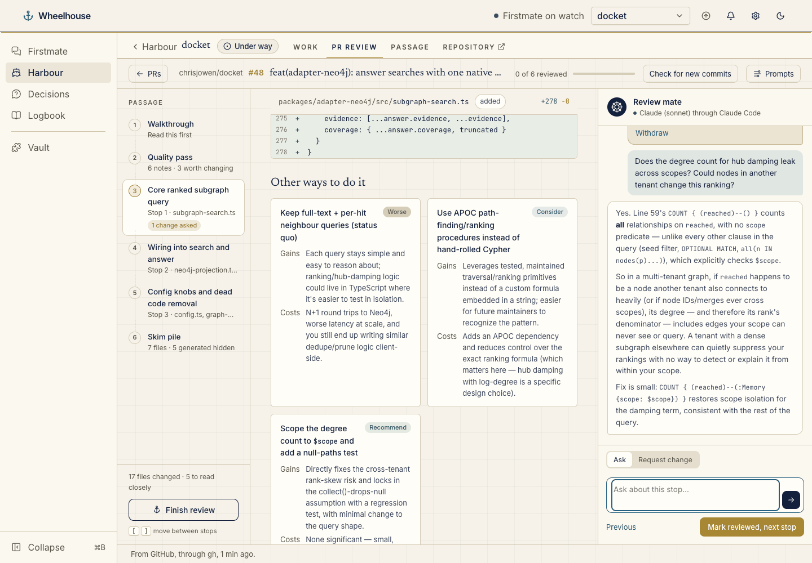
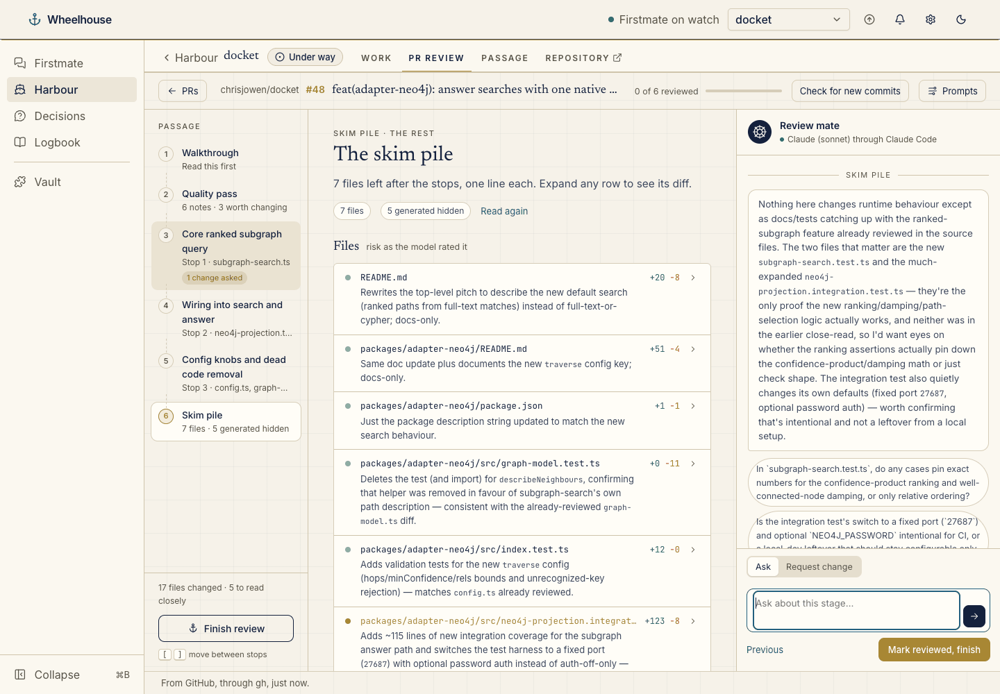
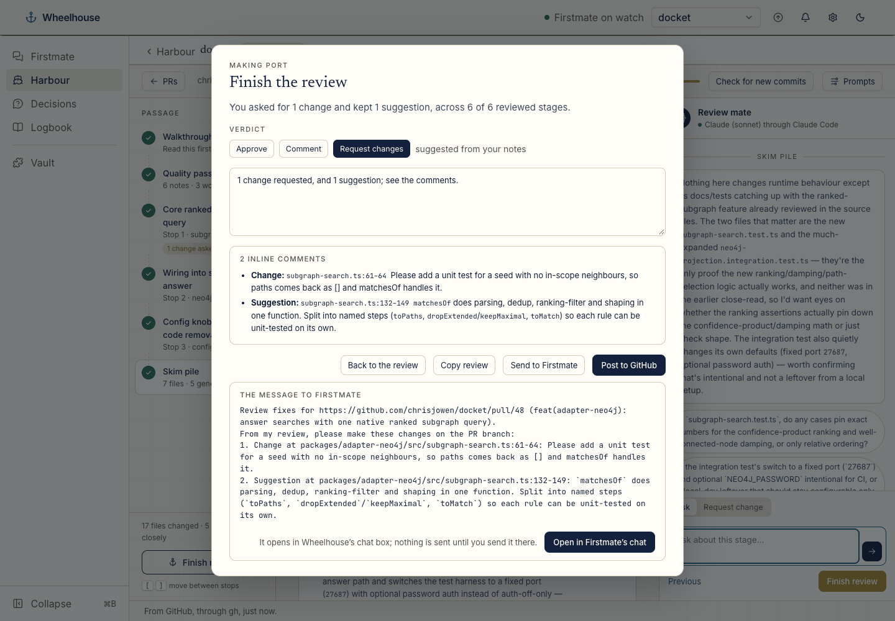

# pr-review-wheelhouse

A [Wheelhouse](https://github.com/chrisjowen/wheelhouse) plugin that adds a **PR review** tab to each project. Point it at a pull request and it walks you through the review in stages instead of handing you the whole list of changed files at once:

1. **Walkthrough**: what the PR does and why, the screenshots and evidence from its description, its checks, where the changed files went, and the reading plan.
2. **Quality pass**: readability and structure only (nesting, long functions, duplication, names). Keep a finding to send it as a suggestion, or dismiss it.
3. **Stops**: the important changes, one to three files at a time, with the reviewer's notes pinned above the lines they discuss, a complexity rating, alternative approaches and its pick.
4. **Skim pile**: everything else, one line and a risk level each. Generated files (build output, lockfiles, snapshots) stay hidden.



A chat sits beside the code at every stage. It opens each stage with the reviewer's take and a few questions you might ask. You can click line numbers to attach lines to a question, or switch it to **Request change** to pin a change request under a line. **Finish review** suggests a verdict from your notes and drafts the review. From there you can post it to GitHub, or send the change requests to Firstmate. Nothing is posted or sent until you click.

The reviewer is Claude by default, run through Claude Code's headless mode. A local model through [Ollama](https://ollama.com) is the other choice (see [Settings](#settings)).

## Install

```sh
wheelhouse plugin install chrisjowen/pr-review-wheelhouse
```

Or use **Settings → Plugins → Install plugin** with `chrisjowen/pr-review-wheelhouse`. The plugin is off until you turn it on in **Settings → Plugins → PR review**, for every project or only some. Each project then gets a **PR review** tab at `/projects/<project>/pr-review/review`.

You need:

- `gh`, signed in (`gh auth login`), to read pull requests and to post reviews;
- [Claude Code](https://claude.com/claude-code) (`claude`), signed in, for the default reviewer; or Ollama with a model pulled (`ollama pull qwen2.5:7b`) if you choose Ollama.

## Using it

The tab lists the project's open pull requests and takes any GitHub PR URL. Nothing is read or reviewed until you click Review. The tab reopens the review you had open last, as the engine kept it, without reading the PR again; **Check for new commits** reads it again with `gh`. `?pr=<number or URL>` on the tab's address does the same for a PR the engine already keeps; any other PR waits in the URL box for your click. The tab declares `opensPullRequest: '?pr={url}'`, so a Review link on a Wheelhouse chat card opens the PR here the same way, and still waits for your click. Older Wheelhouse versions ignore that field.

The first time, the tab asks you to **Start the engine**. The engine is the plugin's companion service, a small server on `127.0.0.1` that does the slow work: reading the PR, the reviewer's passes, the chat, and posting. Wheelhouse starts it only on that click. It keeps running after Wheelhouse stops, and it opens a tab that closes itself.

Opening a PR reads it with `gh` (description, commits, checks and diff), sorts the changed files, and runs the walkthrough. The walkthrough proposes the stops. The plugin holds that proposal to the real file list, so the reviewer can't hide a source file as "generated", put a test or doc in a stop, or leave the biggest change out. The other stages then run one at a time behind the walkthrough, and the stage you are looking at goes first. A review is kept per PR head, so reopening a PR costs nothing, and a new push starts a fresh review.

Move between stages with the passage on the left, **Mark reviewed, next stop**, or the `[` and `]` keys. Each stage has **Read again**, which runs it again with the prompts as they are now.

The quality pass lists readability notes on the changed source, each with its lines and a suggested fix. **Keep** sends a note to the author as a suggestion; **Dismiss** drops it.



At each stop the reviewer's notes sit above the lines they discuss. **Request a change here** pins a change request under those lines, and the chat answers questions about the stop.



Each stop ends with other ways the change could have been written, each with its gains and costs, and the one the reviewer would pick.



The skim pile gives every remaining file one line and a risk level. Expand a row to see its diff.



### Finishing

**Finish review** shows what you asked for and suggests a verdict: _Request changes_ once you have asked for any change, _Comment_ when you have kept only suggestions, _Approve_ otherwise. The draft is editable.

- **Post to GitHub** asks you to confirm. It then posts a pull request review on the head you reviewed. Change requests and kept suggestions that sit inside one hunk of the diff become inline comments; the rest go in the summary with their file and lines. GitHub doesn't let you approve or request changes on your own PR, and the tab says so; post it as a comment instead.
- **Send to Firstmate** shows the message: the PR's URL, then each change with its file and lines. **Open in Firstmate's chat** puts it in Wheelhouse's chat box, the same handoff the GitHub issues plugin uses. Nothing is sent until you send it there.
- **Copy review** copies the summary and comments.



### Prompts

**Prompts** opens the overall review prompt and the four stage prompts (walkthrough, quality pass, stops, skim pile). They are saved for every review as you type. Each pass gets the overall prompt first, then its stage's prompt, then only that stage's context, then a fixed description of the JSON to answer with. That last part isn't editable, so a reworded prompt can't break how the answer is read.


## Settings

Change these in **Settings → Plugins → PR review**, or under `plugins["pr-review"].settings` in Wheelhouse's `plugins.json`. The tab hands them to the engine as it connects, so they apply without restarting the engine.

| Setting                 | Key             | Default                  | What it does                                                                                          |
| ----------------------- | --------------- | ------------------------ | ----------------------------------------------------------------------------------------------------- |
| Reviewer                | `backend`       | `claude`                 | `claude`: Claude through Claude Code. `ollama`: a local model through Ollama.                         |
| Claude model            | `claudeModel`   | `sonnet`                 | The model Claude Code reviews with, such as `sonnet`, `opus` or a full model id.                      |
| Ollama model            | `ollamaModel`   | `qwen2.5:7b`             | The Ollama model each stage runs on, when the reviewer is Ollama.                                     |
| Ollama address          | `ollamaUrl`     | `http://127.0.0.1:11434` | Where Ollama answers.                                                                                 |
| Context window (tokens) | `contextTokens` | `16384`                  | How much an Ollama model reads at once (Ollama's own default, 2048, is too small for a stage's diff). |

### How Claude runs

The default reviewer is `claude -p`, Claude Code's non-interactive mode. It runs once per stage and once per chat answer, and loads none of your own setup:

- `--setting-sources ""`, so none of your user, project or local settings load;
- `--settings` with this plugin's own [`claude-settings.json`](wheelhouse/engine/claude-settings.json), which turns every hook off;
- `--tools ""`, `--strict-mcp-config` and `--disable-slash-commands`, so it has no tools, no MCP servers and no skills, and can only answer;
- `--no-session-persistence`, so no session is saved;
- it runs from the engine's own empty directory, with `FM_NO_LOCK=1`, so it never picks up Firstmate's hooks or lock.

It uses the sign-in Claude Code already has. A Wheelhouse that runs with its own `CLAUDE_CONFIG_DIR` can point the reviewer at another one with `PR_REVIEW_CLAUDE_CONFIG_DIR`; `default` means Claude Code's default.

### A local model instead

With `backend` set to `ollama`, each stage is one Ollama `/api/chat` call. A 7B model such as `qwen2.5:7b` is usable but generic: it takes 20 to 45 seconds a stage on an Apple-silicon Mac, and it is weak at grouping files from a raw diff. That is why the walkthrough reads a manifest of the files (names, kinds and sizes) rather than the diff, and why the plugin checks its grouping.

## Using the engine in another host

The engine and the tab are plain modules, so another host can run them itself. The [PR review web app](https://github.com/chrisjowen/pr-review-app) does, pinning this repo by commit. Nothing here changes the plugin: in Wheelhouse the reviewer is still Claude or Ollama, and the tab is as described above.

### An OpenAI-compatible reviewer

`createOpenAI` in `wheelhouse/engine/model.js` reviews through any OpenAI-compatible chat completions endpoint: [OpenRouter](https://openrouter.ai), OpenAI, or a server of your own (vLLM, llama.cpp, Ollama's `/v1`). The plugin's settings don't offer it; a host builds it and hands it to `createReviews` and `createHandler` as `main.js` does with the other two.

```js
import { createOpenAI } from 'pr-review-wheelhouse/wheelhouse/engine/model.js';

const model = createOpenAI({
	baseUrl: 'https://openrouter.ai/api/v1',
	apiKey: process.env.OPENROUTER_API_KEY, // read from the environment, never committed
	model: 'anthropic/claude-sonnet-4.5',
	maxTokens: 8000
});
```

| Option        | Default    | What it does                                                                                    |
| ------------- | ---------- | ----------------------------------------------------------------------------------------------- |
| `baseUrl`     | (required) | The API's base address; the engine posts to `<baseUrl>/chat/completions`.                       |
| `apiKey`      | none       | Sent as `Authorization: Bearer <key>`. Leave it out for a local server that needs none.         |
| `model`       | (required) | The model id the provider knows, such as `anthropic/claude-sonnet-4.5` on OpenRouter.           |
| `maxTokens`   | `0` (none) | Caps each answer (`max_tokens`), so a host can bound what one call may cost before it makes it. |
| `temperature` | `0.2`      | Sampling temperature.                                                                           |
| `headers`     | `{}`       | Extra request headers, such as OpenRouter's `HTTP-Referer` and `X-Title`.                       |
| `timeoutMs`   | 5 minutes  | How long one answer may take.                                                                   |

Each answer is streamed, and asks for usage in its last chunk. Besides the usual text and token counts it reports `costUsd`, the cost the provider says the call had (OpenRouter's `usage.cost`), or `null` when the provider doesn't say.

### Cards: one verdict per change

The engine also writes the review as **cards**, one per change, for a host that shows a review a change at a time (the web app does). The plugin's tab doesn't show them yet: it reads the same passes as quality findings and stop notes, as before.

Cards cost no extra calls. The stops, the quality pass and the skim pile each write their cards in the one call they already make, and the walkthrough lists what the PR was asked to do (its acceptance items, from the description) for the cards to check against. A card's chat reads only that card, its lines and its own files, so it is cheaper than a stage's.

Every card has one main verdict from a fixed set and at most one secondary one:

| Verdict                          | Id          | Family  | Accepted, it becomes                       |
| -------------------------------- | ----------- | ------- | ------------------------------------------ |
| Exemplary                        | `exemplary` | praise  | a line under "What works well"             |
| Looks good                       | `lgtm`      | praise  | a line under "What works well"             |
| Explanation                      | `explain`   | neutral | nothing; it's noted                        |
| Code smell                       | `smell`     | concern | a suggestion                               |
| Over-complex                     | `complex`   | concern | a suggestion                               |
| Not well tested                  | `untested`  | concern | a change request                           |
| Performance risk                 | `perf`      | concern | a change request                           |
| Doesn't meet acceptance criteria | `ac`        | concern | a change request                           |
| Possible security issue          | `security`  | concern | a change request; it always has a severity |

The set, with each verdict's meaning, is `CARD_VERDICTS` in [`wheelhouse/ui/cards.js`](wheelhouse/ui/cards.js), which a page can import as it is.

A card, as kept in `results[stage].cards`:

```js
{
	id: 'stop-1:c2',            // the stage's id, then the card's place in it
	stage: 'stop-1',
	verdict: 'security',
	secondary: 'untested',      // or null
	severity: 'low',            // with security only; else null
	title: 'The degree counts relationships in other scopes',
	why: 'What the change does and why it earns the verdict.',
	suggestion: 'Count only edges in scope.', // concerns only; else ''
	ask: 2,                     // the acceptance item it checks, or null
	asked: 'Rank by score times path confidence', // what was asked, for ac
	file: 'src/subgraph-search.ts', from: 59, to: 60, // or null: about the change as a whole
	blocks: [{ file, from, to }], // the lines it shows: its own, then up to two more
	take: 'The reviewer’s opening line in the card’s chat.',
	questions: ['Suggested questions for the card’s chat']
}
```

Every answer that is a review also carries **`deck`**, the review laid out as cards. It is worked out for each answer and never kept:

| Field      | What it holds                                                                                                                                                                                                                                                                                                                                                                                                                                                                                                   |
| ---------- | --------------------------------------------------------------------------------------------------------------------------------------------------------------------------------------------------------------------------------------------------------------------------------------------------------------------------------------------------------------------------------------------------------------------------------------------------------------------------------------------------------------- |
| `verdicts` | `CARD_VERDICTS`.                                                                                                                                                                                                                                                                                                                                                                                                                                                                                                |
| `groups`   | The passage, in reading order: **Walkthrough** (with `asks`, each acceptance item and the cards that check it), **Key changes** (with `stops`, each stop's title, files and cards), **Quality pass** (its own cards, and `checklist`: every concern in the review, with its decision), **Skim pile** (with `files`, one line each) and **Generated** (`hidden: true`, with `files` and one card, made without the model). Each group has its `stages`, `state`, `cards` (ids), `look` (concerns) and `decided`. |
| `cards`    | Every card in reading order, each with its `group` and the captain's `decision` (or null).                                                                                                                                                                                                                                                                                                                                                                                                                      |
| `counts`   | How many cards have each verdict.                                                                                                                                                                                                                                                                                                                                                                                                                                                                               |
| `remember` | The disagreements and comments the captain asked to remember: `{ card, scope, verdict, decision, text, file, repo, at }`. Nothing reads these back yet.                                                                                                                                                                                                                                                                                                                                                         |

A page acts on cards with two calls:

- `POST /api/reviews/<id>/card` with `{ card, decision, text, remember }` records the captain's decision: `accept`, `disagree` (with an optional reason) or `comment` (with its text), or `null` to take it back. `remember` is `pr`, `me` or `repo` (who to remember a disagreement or comment for), or `null`.
- `POST /api/reviews/<id>/ask` with `{ stage, card, text }` asks in that card's own chat. The answer arrives in `chat[<card id>]`, as a stage's does in `chat[<stage id>]`.

Reading a stage again writes new cards, so it drops that stage's cards' chats and decisions.

The draft review counts the card decisions along with the change requests and kept suggestions: an accepted blocking concern makes it **Request changes**, other accepted concerns and comments make it **Comment**, and each sits inline on its lines when they are inside one hunk. Accepted praise goes under "What works well"; disagreements add nothing.

A review kept from before cards, and an answer in the older shape, still read as cards: each quality finding becomes a code smell, and each stop note an explanation (or a code smell when it raised a concern).

### What the host lets the tab do

The tab reads `host.features`. Wheelhouse sets none of them, so the plugin keeps its defaults.

| Feature     | Default | What it does                                                                                                        |
| ----------- | ------- | ------------------------------------------------------------------------------------------------------------------- |
| `post`      | on      | **Post to GitHub** in Finish review. Off, the copy button becomes the main one.                                     |
| `firstmate` | on      | **Send to Firstmate** in Finish review.                                                                             |
| `markdown`  | off     | The copy button becomes **Copy as Markdown**: the PR, the verdict, the commit reviewed, the summary and line notes. |
| `autoOpen`  | off     | A `?pr=` link the engine doesn't keep opens straight away instead of waiting for a click on Review.                 |

When a host's `github.post` answers with an `event` other than the one asked for (say, a comment on the captain's own pull request) and a `note` saying why, the review keeps both in `posted`.

The tab's data can also carry `settings.label`, the reviewer's name to show, and `settings.where`, how it runs (shown after the name, such as "through OpenRouter"). The Markdown copy comes from `reviewMarkdown(review, finish, body, draft)`, exported from `wheelhouse/ui/index.js`.

## What it reads and writes

The Wheelhouse side is read-only. Its provider runs one `gh pr list` in the project's clone to list the open pull requests.

The engine:

- reads with `gh pr view` and `gh pr diff`;
- posts with `gh api -X POST repos/<owner>/<repo>/pulls/<n>/reviews`, only from **Post to GitHub** after you confirm;
- keeps your prompts and one file per review in its state directory: `$PR_REVIEW_STATE_DIR`, else `$XDG_STATE_HOME/pr-review-wheelhouse`, else `~/.local/state/pr-review-wheelhouse`.

It answers only on `127.0.0.1`, and only requests that name this computer as their host. A request from a page must come from a page on this computer, and a request that changes anything must carry a header that a plain form from another site can't send.

## Development

```sh
npm install
npm run lint   # eslint and prettier
npm test       # node --test
npm run engine -- --port 4791   # the engine on its own
```

The plugin has no runtime dependencies and no build step. Wheelhouse imports `wheelhouse/server/index.js` and serves `wheelhouse/ui/` to the page as is.

- `.wheelhouse-plugin/plugin.json`: the manifest.
- `wheelhouse/server/index.js`: the open-PRs provider, the tab and the engine service.
- `wheelhouse/engine/`: the engine.
  - `main.js` and `http.js`: the server.
  - `review.js`: the review sessions and the one-at-a-time queue.
  - `stages.js` and `classify.js`: grouping the files into stages.
  - `prompts.js`: assembling the prompts and reading the answers.
  - `model.js`: the reviewer, Claude Code, Ollama or an OpenAI-compatible API, behind one interface.
  - `github.js`: `gh`.
  - `diff.js`: reading the diff.
- `wheelhouse/ui/`: the `pr-review-tab` element.
  - `draft.js`: drafting the GitHub review and the Firstmate message, shared with the engine.
  - `cards.js`: the verdict set and the deck of cards, shared with the engine.

The tests use a fake `gh`, a fake model and a fake `claude`, so they need none of the three installed.

## Licence

MIT
